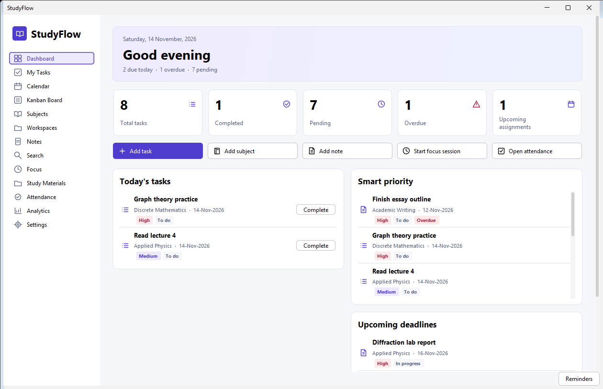

# StudyFlow

StudyFlow is a local-first Java desktop workspace for university tasks, subjects, workspaces and notes.



## Run the packaged application

With Java 21 installed, open a terminal in the directory containing `StudyFlow.jar` and run:

```powershell
java -jar StudyFlow.jar
```

The app reads and writes `data` in the working directory. Use `java -jar StudyFlow.jar --data-dir "C:\StudyFlow data"` to choose another profile.

## Prerequisites

- JDK 21. On Windows, install or extract an x64 or ARM64 build as appropriate. Set `JAVA_HOME` to the JDK directory and put its `bin` directory on `PATH`. [Microsoft OpenJDK installation](https://learn.microsoft.com/en-us/java/openjdk/install)
- Apache Maven 3.9 or newer. Download the binary ZIP, extract it and add the Maven `bin` directory to `PATH`. A new terminal will read your updated environment. [Apache Maven installation](https://maven.apache.org/install.cgi)
- A desktop session with graphics for Swing. The first Maven build needs network access to resolve dependencies.

Verify the tools in a new terminal.

```powershell
java -version
javac -version
mvn -version
```

All three should report Java 21 for the Java toolchain. Run these commands from the directory containing `pom.xml`.

If you are running this delivered copy in the original Codex workspace, you can activate its verified JDK and Maven for the current PowerShell session.

```powershell
$env:JAVA_HOME = (Get-ChildItem '..\..\work\tools\jdk' -Directory | Select-Object -First 1).FullName
$mavenBin = (Resolve-Path '..\..\work\tools\apache-maven-3.9.16\bin').Path
$env:Path = "$env:JAVA_HOME\bin;$mavenBin;$env:Path"
```

```powershell
mvn clean compile
mvn test
mvn exec:java '-Dexec.mainClass=com.studyflow.Main'
mvn clean package
```

The Maven package command builds `target/StudyFlow.jar` with its runtime dependencies.

StudyFlow opens to the Dashboard. It shows live task totals, today's deadlines, the next seven days of deadlines, and Smart Priority. Use **Complete** on a due-today task to update its status and the dashboard counts.

- **My Tasks** supports general tasks, assignments, exams and study sessions. Select a row to view its details or change its priority or status. Use **Apply** to combine search, filters, date bounds and sorting.
- **Notes** are for lecture notes, revision and ideas. Choose **Save note** or press **Ctrl+S** to write them to the current profile's `notes/notes.json`. Search saved notes or open the subject a note belongs to.
- **Workspaces** group subjects for a semester, project, or exam. Pick the included subjects, then use the workspace's **Subjects**, **Tasks**, and **Notes** tabs to browse their records. A subject with linked records must be unlinked before deletion.
- **Settings** switches between Light and Dark immediately and saves the theme for the next launch.
- **Calendar** filters deadlines by subject and lets you edit a deadline or its subject. **Kanban** shows progress by status and highlights overdue deadlines. Use a task’s context menu to manage recurrence and subtasks.
- **Focus** offers presets and custom timer lengths. Use **Ctrl+Space** to start or pause from the Focus panel. Completed focus time can be linked to a task or subject.
- **Attendance** records class outcomes and corrections, and calculates classes you need to attend or can miss. **Analytics** summarizes recorded task, focus and attendance activity.
- **Study Materials** imports PDFs. The **Study Assistant** retrieves cached, page-numbered passages and creates study aids. **History** shows saved outputs and citations and can reuse a request. Turn off **Save in local history** before a run to skip saving it, or clear previous entries from **History**.

## Optional integrations

- **Google Calendar** is available from **Calendar → Google Calendar**. Export selected deadlines as an `.ics` file without signing in. For live sync, enable the Google Calendar API in a Google Cloud project, create a Desktop app OAuth client, and set `STUDYFLOW_GOOGLE_CLIENT_ID` and `STUDYFLOW_GOOGLE_CLIENT_SECRET` in the launch environment. Choose **Connect Google**, authorize in the browser, then sync selected tasks. StudyFlow marks linked tasks and sends current subject details when you sync again. Reconnect after restarting StudyFlow. [Google Desktop OAuth setup](https://developers.google.com/identity/protocols/oauth2/native-app)
- **Spotify** stores a saved `https://open.spotify.com` link and opens it using your system browser. Playback belongs to Spotify.
- **OpenAI** uses `OPENAI_API_KEY` and optionally `STUDYFLOW_OPENAI_MODEL`. Settings can test model access without sending document content. A remote study request sends selected passages only after confirmation. Local study modes work without credentials. [OpenAI Responses API](https://developers.openai.com/api/reference/resources/responses/methods/create)

Scanned PDFs without a text layer need OCR before text retrieval. The app uses one-way, explicitly selected Google Calendar sync. Optional live services require your own accounts and were tested through offline or simulated checks in this build.

## Local data and recovery

By default, StudyFlow uses the `data` directory in the working directory. It writes separate JSON files for tasks, academic records, settings, focus history, attendance and integration links. Managed PDFs and extracted text are stored separately. To launch against an alternate location with Maven, pass `--data-dir` to the application via Maven Exec.

```powershell
mvn exec:java "-Dexec.args=--data-dir 'C:/StudyFlow data'"
```

When a saved file changes, StudyFlow keeps a timestamped copy of the preceding valid file under `data/backups`. Saving requires a filesystem that supports atomic file replacement.

To back up the latest saved file, close StudyFlow and select its type (`tasks`, `subjects`, `workspaces`, `notes` or `settings`).

```powershell
mvn exec:java '-Dexec.args=--backup tasks'
```

The command validates the profile and saves an exact copy under `data/backups`, with a name like `tasks-manual-<UTC timestamp>-<uuid>.json`. It prints the full path. If the selected type has no saved file yet, the command reports an error. To back up an alternate profile, put `--data-dir` before `--backup`.

To recover a file, close StudyFlow, choose an automatic or manual backup, and pass the corresponding type. The CLI validates the backup against the current profile before replacing the file. It preserves the previous file for inspection, including damaged data.

```powershell
$backup = (Resolve-Path 'data/backups/tasks-manual-<timestamp>-<uuid>.json').Path.Replace('\', '/')
mvn exec:java "-Dexec.args=--restore tasks '$backup'"
```

Use `--data-dir` before `--restore` when recovering an alternate profile. Restart StudyFlow after a successful restore.

## Project documentation

- [Software requirements](docs/SRS.md)
- [Architecture and UML](docs/architecture.md)
- [Design decisions](docs/design-decisions.md)
- [Development log](docs/development-log.md)
- [Java concept mapping](docs/java-concept-mapping.md)
- [Stage reports](docs/stage-reports)
- [Stage 7 GUI and dashboard report](docs/stage-reports/stage-7-report.md)
- [Testing](docs/testing.md)
- [User manual](docs/user-manual.md)
- [Project report](docs/project-report.md)
