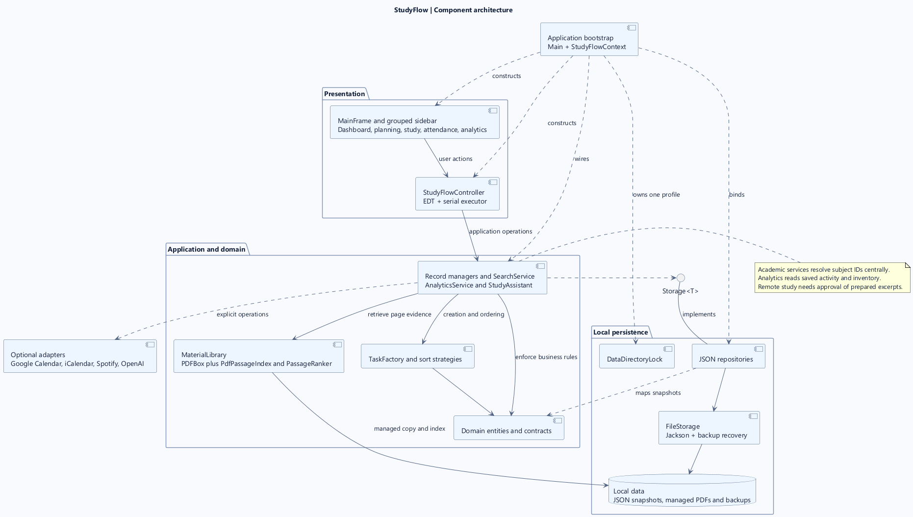

# StudyFlow project report

This report preserves the original project stages. See the [0.2.0 completion report](stage-reports/premium-completion-report.md) and [final checklist](final-checklist.md) for the later Java 21 Swing release, its study and analytics changes, and actual verification.
## Design and development of a student productivity and academic management system using Java

StudyFlow consolidates assignments, deadlines, notes, attendance, and study materials into a single desktop workspace. The application was implemented in twelve checkpoints, starting with requirements and UML and ending with a packaged desktop build. This report describes the design, algorithms, testing approach, and operating boundaries of the release.

### Problem and objectives

Students frequently combine separate notebooks, task boards, calendars, and document folders. That creates repeated data entry and makes deadline and subject information harder to find. StudyFlow gives each student one local profile with subject-linked records, task views, attendance projections, and PDF study tools.

- Make common tasks available through a desktop interface during normal offline use.
- Keep validation and persistence independent of Swing so business rules can be tested in isolation.
- Preserve saved records through restart and recover individual JSON files from validated backups.
- Demonstrate maintainable Java OOP and suitable patterns with a source tree that supports a viva and incremental development.

### Development stages

| Stages | Delivered capability |
| --- | --- |
| 1-3 | Requirements, architecture and editable UML, Maven and Swing foundation, Java domain model and validation. |
| 4-6 | Typed tasks and recurrence, academic records and search, validated JSON persistence and file recovery. |
| 7-8 | Dashboard, desktop forms, calendar, Kanban, reminders, focus timer, and global search. |
| 9-10 | Attendance tracking and exact projections, PDF library and page-linked study aids. |
| 11-12 | Google Calendar sync and offline export, Spotify link launcher, optional OpenAI requests, analytics totals, release verification, and packaging. |

<!-- pagebreak -->

## Architecture and object-oriented design

Java 21 provides the language baseline and runtime. Maven builds and tests the standard source layout. Swing and AWT handle native UI widgets and events, with FlatLaf supplying persisted light and dark themes. Jackson binds JSON snapshots, PDFBox extracts local PDF text, and JUnit Jupiter exercises the domain and persistence layers.

### Responsibility by layer

| Layer | Responsibility |
| --- | --- |
| View and controller | Swing owns rendering and user interaction on the Event Dispatch Thread. The controller queues I/O and applies results on that thread. |
| Model and services | Domain objects enforce intrinsic rules. Services manage references, recurrence, queries, attendance forecasts, and retrieval. |
| Persistence | Typed repositories convert records to validated snapshots. File storage stages replacement and preserves earlier versions. |
| Integrations | Application services call optional external adapters via defined boundaries. Core data stays available locally. |

### Patterns and course concepts

- The task hierarchy uses an abstract base, concrete subtypes, overriding, and polymorphism. The factory creates the appropriate subtype from a typed draft.
- Search and persistence use interfaces. Deadline, priority, title, and creation-date strategies supply interchangeable comparators.
- Task subtasks form an owned tree. Workspaces organize independent subjects through stable IDs, preserving references across updates without duplicating subject data.
- The Maven tests and `docs/java-concept-mapping.md` provide examples for exceptions, collections, concurrency, encapsulation, and advanced patterns.

<!-- pagebreak -->

## Core algorithms and data integrity

### Tasks and academic records

Tasks can be general tasks, assignments, exams, or study sessions. A task is overdue when its deadline precedes the current local date and it is incomplete. Today matches the exact local date. Upcoming covers tomorrow through day seven. Smart Priority orders incomplete tasks by urgency band, then priority, deadline, title, and identifier. Recurring root tasks create one successor on completion, with advancement saved with the completed occurrence. Their deadline moves from the current occurrence by the selected interval.

Subjects and notes can be grouped through workspaces. A subject rename appears through ID resolution. Removing a workspace leaves its subjects independent. The subject deletion checks preserve linked records and surface which references must be removed.

### Attendance and document retrieval

Attendance tracks individual dated outcomes with optional subject targets. Exact integer ceiling and floor arithmetic calculates how many attended classes are needed to regain a target and how many additional absences are possible. Display percentages are rounded for presentation. When a student has missed a class, an exact 100 percent target becomes unreachable.

PDFBox extracts text page by page into a local cache. Search ranks text passages by matching query terms. The study assistant returns summaries, excerpts, key points, formula candidates, revision prompts, or explanations with references that identify the PDF and page. Local modes use the indexed text. Optional generation depends on a configured provider.

### Persistence and lifecycle

StudyFlow acquires an exclusive profile lock, loads record collections, validates IDs and cross-record links, and starts the desktop only after valid initialization. Mutations are staged off the UI thread. For JSON snapshots the file layer validates the candidate, writes a temporary sibling file, preserves the previous data, and uses atomic replacement. Restore reads the selected backup and validates it against the profile before replacement. On close, queued work drains and the profile lock is released.

### Scope and operating boundaries

- A profile belongs to one desktop user and can be opened by one running StudyFlow writer.
- JSON backup and recovery work per record type. Managed PDF copies and their text cache reside in the profile and should be included in a whole-profile copy.
- Text extraction requires readable text in the source PDF. Scanned pages need prior OCR. Technical notation and generated study aids should be checked against the source.
- Google Calendar sync sends explicitly selected task deadlines to the account's primary calendar. The access token lives in memory for the session. Offline iCalendar export is also available.
- Spotify links open in the system browser. Optional OpenAI generation sends selected passages and the user's study request after opt-in.

<!-- pagebreak -->

## Verification and release

### Verification matrix

The Stage 11 checkpoint passed 129 automated tests, including 13 simulated OpenAI transport tests and 15 offline calendar and Spotify tests. The Stage 12 report records the release packaging and end-to-end verification results.

| Area | Evidence |
| --- | --- |
| Domain and services | JUnit covers task subtypes, status changes, recurrence, filters and sorting, references, academic CRUD, and deletion policy. |
| Storage and startup | Isolated temporary profiles verify JSON round trips, malformed files, timestamped backups, explicit restore, locking, and reopened records. |
| Planning | Timing and local state are tested through the focus and planning services. Windows Swing probes exercise user-visible planning controls. |
| Attendance | Unit tests cover edge cases, targets, projections, history, and correction. Windows Swing verification exercises the views with real data. |
| Study materials and integrations | Local PDF fixtures cover extraction, references and restart. Integration verification uses isolated and simulated requests. Live provider accounts were unavailable for testing. |
| Packaging | See the Stage 12 report for the final Maven count, Windows smoke checks, artifact checks, and limitations. |

### Handoff

- The Maven source project includes production and test code, stage reports, editable PlantUML sources, and rendered diagrams.
- `StudyFlow.jar` packages application dependencies and starts with Java 21 on a graphical desktop.
- The user manual covers installation, desktop workflows, integrations, and backups.
- `docs/stage-reports/` records checkpoint-level tests and outstanding limitations. `docs/architecture.md` links to the UML assets. `README.md` provides build, run, and test commands.

### Project conclusion

StudyFlow achieves its central goal of bringing recurring academic tasks, subject organization, attendance, and source-linked study into one workspace. The layered design lets desktop, persistence, and integration behavior evolve independently while preserving the validated records and service contracts used by earlier stages.
